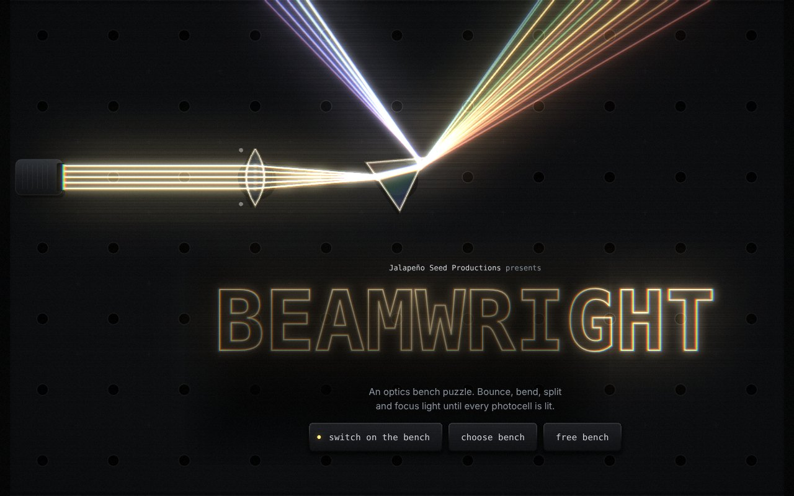
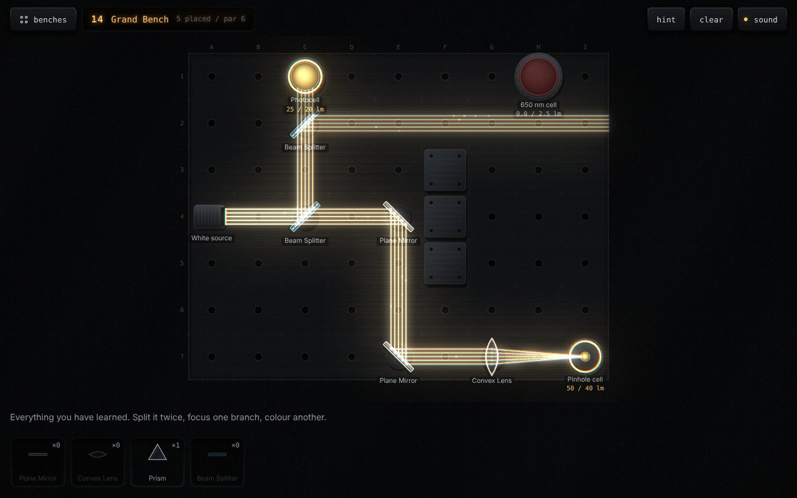

# Beamwright

**An optics bench puzzle game by Jalapeño Seed Productions.**
Mount mirrors, lenses, prisms, fibers and stranger glass on an optical breadboard, and steer real ray-traced light into every photocell.





## Play

Open `dist/index.html` in any modern browser. It is one self-contained file with no install and no server.
Once GitHub Pages is switched on for this repo (see below), it is also playable at `https://<user>.github.io/beamwright/`.

- **Drag** a part from the rack onto any free hole on the bench, or tap a part and then tap a hole.
- **Tap** a mounted part to select it, and tap again to turn it 15°. You can also drag the knob on its degree ring, use the mouse wheel, or press `Q` / `E`.
- **Drag** a part off the bench, or press **return**, to put it back in the rack.
- Light every cell to finish the bench. You earn three lamps if you use no more parts than par.

### Menus and navigation

- **menu** (top left) or `Esc` opens the in-game menu: resume, restart, previous / next bench, choose bench, the bench maker and the main menu. `Esc` also closes any open panel.
- Every menu works from the keyboard: `Tab` or the arrow keys move between keys, `Enter` presses one. The bench picker moves through its grid with the arrow keys.
- From the title you can start, pick a bench, open the free bench or open the bench maker.

## Bench maker

Build your own benches and share them as codes. Open it from the title screen, the bench picker, or the in-game menu.

- **Tools:** lay light sources, photocells and walls (drag across the bench to paint or clear walls), erase anything, and bolt down fixed parts from all 14 kinds.
- **Inspector:** tap anything you placed to turn it, recolour it (white light or a coloured laser; cells can ask for one colour), change how many lumens a cell needs, give it a pinhole aperture, or remove it.
- **bench:** name, size (5–11 × 4–8), a tip for players, and how many of each part the player gets.
- **check** runs the same solver that set par for the campaign (in a background worker). It tells you whether the bench can be solved with the parts you gave, sets par to the fewest parts that work, and stores that solution as the bench's hint. It also warns you if the bench is already solved with nothing placed.
- **test** plays your bench exactly as a player would; finishing it takes you back to the maker.
- Benches are saved in your browser under **My benches** in the picker. **Share code** gives a `BW1-…` code anyone can paste into **Open a code**.
- **Submit** (in bench settings) sends a checked bench to be added to the game for everyone; see below.

## Community benches

Player-made benches ship in the game under **community benches**, with the maker's name on them. Players can remix any of them in the bench maker.

How a bench gets in:

1. In the bench maker, the player presses **check**, then **submit** in bench settings. That opens a "Submit a bench" issue on this repo with the code filled in.
2. A workflow (`.github/workflows/bench-submission.yml`) decodes the code, runs the solver on it, and replies on the issue with the size, the parts, and par, or with what's wrong.
3. You play it. If you like it, add the `accepted` label. The workflow saves it to `community/benches/`, commits it, closes the issue and redeploys.

Codes posted in itch.io comments go in by hand: `npm run community:add -- BW1-… --author "Name"`. See `community/README.md` for the details and the one-time setup (two labels, and write permission for workflows).

## What's on the bench

The light is genuinely ray-traced: each source fires five parallel rays, and every part bends them by real optics (Snell's law, total internal reflection, ideal thin lenses and mirrors). Dispersion is exaggerated so a bench-sized prism fans the spectrum visibly.

| Chapter I · The Bench | Chapter II · Exotic Optics |
|---|---|
| Plane mirror, beam splitter | Critical angle block (total internal reflection at 42°) |
| Concave and convex mirrors | Cat's eye retroreflector (an n = 2 ball lens with a silvered back) |
| Convex and concave lenses | Optical fiber and fiber bends that join end to end |
| Tilted glass block | Water droplet (internal reflection makes the rainbow) |
| Prism (white light into six bands) | Diamond (n ≈ 2.4, trapped light comes out as "fire") |
| | Hot-air mirage (a gradient-index zone that curves light upward) |

There are 22 benches in two chapters, plus a **Free bench** sandbox with every part unlimited and a **bench maker** for your own.

## Intro, music and trailer

- **Intro:** the game opens on a "switch on" key (browsers need a tap before they'll play sound). Then comes the Jalapeño Seed Productions ident: a beam strikes a seed, a jalapeño traces itself in green light, the studio name glows in, and a short sting plays. A tap skips it.
- **Music:** two original tracks, synthesized live from pure sine and triangle voices (glassy plucks, warm pads, soft bass, light percussion; nothing vocal).
  - The **title theme** runs at 112 BPM, the same tempo as the light drum machine. It opens on pads and an arpeggio, then bass and drums come in, then a glass-bell melody.
  - The **bench picker** has a calmer 84 BPM track.
  - Music fades out when a bench starts, because the light takes over the rhythm there.
- **Trailer:** `npm run trailer` films a 32-second, 1280×720 trailer straight from the game. It drives the build frame by frame on a virtual clock, scripts the scenes through `window.__bw`, logs every sound the game makes, renders the soundtrack offline with the same synth, and muxes it with ffmpeg. It needs Playwright (`npm i -D playwright`) and ffmpeg.

## Publish on itch.io

`npm run itch` builds the game and writes `itch-build/beamwright-html5.zip` (just `index.html` inside, because the game is one file). Everything else the itch page needs is in `itch/`: the cover, five screenshots, and `itch/page.md`, which has the description and every setting to pick.

1. On itch.io: **Upload new project**, then set **Kind of project** to **HTML**.
2. Upload the zip and tick **This file will be played in the browser**. Set the embed to **1280 × 720**, and tick **Mobile friendly** and **Fullscreen button**.
3. Add the cover, screenshots and description from `itch/`, save as a draft, play it on the page, then make it public.

After the first upload, GitHub can push every update for you. The deploy workflow pushes to itch with [butler](https://itch.io/docs/butler/) once two things are set in the repo's **Settings → Secrets and variables → Actions**:

- the secret `BUTLER_API_KEY` (create a key at itch.io → Settings → API keys)
- the variable `ITCH_GAME`, for example `jalapenoseed/beamwright`

The game keeps progress and your own benches in the browser's local storage, which works inside itch's player. Copying a share code also works there: itch blocks the clipboard API, so the game falls back to an older copy method.

## Look and sound

- **Rendering:** a WebGL 2 compositor takes two 2D layers (the parts, and the additive light) and paints the final frame. That frame shows a black-anodized breadboard with a tapped hole in every cell, light spilling onto the metal, bloom, slight chromatic fringing and grain. The shader also draws every key, rack pocket, panel, amber readout window and indicator lamp; the HTML only provides text and hit areas. Devices without WebGL 2 get a plain 2D fallback.
- **Emitters and photocells:** each source is a laser head on a fork clamp: a finned tube, a coloured ID band (a spectrum band for white light) and a lens that glows. Its lens flares when it fires the pulse on the downbeat. Each photocell is a silicon die in a knurled can. It sits behind a filter glass if it only takes one colour, and pinhole cells close an iris over it. A ring of 24 LED segments fills as light arrives. The die flashes when a pulse lands, and a ripple runs out when the cell switches on.
- **Sound: the light is the drum machine.** Every source fires a pulse of light on the downbeat, and it travels one cell per 16th note at 112 BPM. Each place a ray meets something becomes a drum hit at that step, so the shape of your light path *is* the beat:

  | Light meets | Hit |
  |---|---|
  | source firing | soft kick |
  | plane mirror | closed hi-hat |
  | beam splitter | flammed hi-hat |
  | lens | glassy tok |
  | curved mirror | rimshot |
  | prism, droplet or diamond splitting white light | shaker with sparkle |
  | glass surface | tiny glass tick |
  | total internal reflection | glass tink, and a roll of soft ticks down a fiber |
  | cat's eye | rising blip |
  | photocell | kick-tom thump |
  | wall | muffled thud |
  | the bench edge | a hiss that fades out |

  A bright packet of light runs along the beams in time with the hits. The pattern loops while you play and re-fires whenever you change the path. Under the beat sit the original sounds: a sustained tone for each lit photocell, a low bench hum, and glass bells for placing parts. Finishing a bench plays a short, quiet phrase in the title theme's key and tempo: a plucked rising figure over a soft pad, one bell and a little sparkle. Everything is synthesized with the Web Audio API; there are no samples.
- **Nudges:** if you leave an unsolved bench alone for 15 seconds, the hint key starts to glow. After a bench is complete, the next-bench key is lit amber.

## Project layout

```
src/
  index.html   markup and styles; the build inlines everything into it
  engine.js    the optics engine: scene building, ray intersection, refraction, dispersion
  levels.js    all 22 benches
  game.js      state, input, menus, level flow, and the 2D layers
  maker.js     the bench maker: tools, inspector, settings, check, submit
  community.js community benches in the picker, playing and remixing them
  codes.js     BW1 share codes (encode, validate, decode); also used by tools/community.js
  solver.js    iterative-deepening solver shared by tools/, the maker and its worker
  boot.js      start-up once fonts are ready
  gl.js        WebGL 2 compositor and the shader that draws the table and UI plates
  audio.js     synthesized sound
data/
  solutions.json   par and hint solution per level (generated)
tools/
  build.js     bundles src/ into dist/index.html
  verify.js    proves every level is solvable and not already solved
  solver.js    command-line wrapper around src/solver.js
  solve.js     regenerates data/solutions.json
  trailer.js   films dist/trailer.mp4 from the game itself
  community.js checks, adds and verifies community benches (also runs in the submission workflow)
  itch.js      packages the build for itch.io
community/benches/ accepted community benches, one JSON file each
itch/              cover, screenshots and page text for itch.io
.github/           deploy workflow (Pages + itch), bench submission workflow, issue form
dist/index.html    the built game
```

## Develop

Requires Node 18 or newer. There are no dependencies.

```sh
npm run build     # src/ -> dist/index.html
npm run verify    # every campaign and community bench: hint solution wins, empty bench doesn't, parts fit
npm run itch      # build, then package itch-build/beamwright-html5.zip
npm run solve     # recompute par and hints (add a level index to solve just one: npm run solve -- 7)
npm test          # verify + build
```

A level is a plain object in `src/levels.js`: board size, sources, targets (with lumens needed, optional colour and aperture), walls, fixed parts, mirage zones and the parts inventory. After adding one, run `npm run solve -- <index>` and `npm run verify`.

## Publish on GitHub Pages

The workflow in `.github/workflows/deploy.yml` runs `verify` and `build` on every push to `main`, and deploys `dist/` to GitHub Pages (and to itch.io, once that's set up). To use Pages, open the repository's **Settings → Pages** and set **Source** to **GitHub Actions**.

The repository is expected at `jalapenoseed/beamwright`. If you use another name, change `repository` in `package.json` so the game's **submit** key opens the right issue form.

## Credits

Made by **Jalapeño Seed Productions**. Inspired by a YouTube Shorts video that sent light through a parade of optical elements.
Typefaces: B612 and B612 Mono (SIL Open Font License), loaded from Google Fonts.
Code is released under the MIT License (see `LICENSE`).
